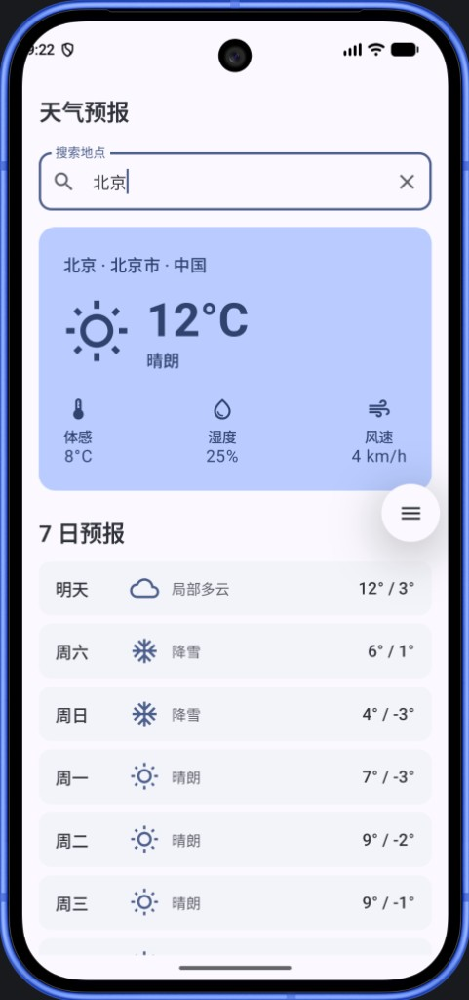

# 天气预报 App（Android）

Kotlin + Jetpack Compose（Material 3）实现的天气预报应用，按 Clean Architecture 分层，MVVM + UI State 驱动界面。天气数据来自免费的 [Open-Meteo](https://open-meteo.com/)（无需 API Key）。

对应作业文档：`Frontend_Take_Home_Weather_Application Chinese.pdf`

## 功能

- 按城市名搜索地点（Geocoding，防抖）
- 查看当前天气：温度、体感、湿度、风速、天气描述/图标
- 查看未来 7 日预报：最高/最低温、天气状况
- Loading / Error 状态展示，支持重试
- 启动时默认加载北京天气，避免空白首页

## App 预览

<p align="center">
  
</p>

## 运行方式

### 环境要求

- Android Studio Ladybug / Koala 或更新版本
- JDK 17 或 21（推荐）
- Android SDK（compileSdk 35）
- 模拟器或真机，API 26+

### 打开与运行

1. 用 Android Studio 打开本目录（`WeatherForecastApp`）
2. 等待 Gradle Sync 完成
3. 选择模拟器或真机，点击 Run

命令行构建（需本机已配置 `ANDROID_HOME` 与 JDK 17/21）：

```bash
./gradlew assembleDebug
```

Debug APK 输出路径：`app/build/outputs/apk/debug/app-debug.apk`

> `local.properties` 中的 `sdk.dir` 按本机 Android SDK 路径配置；该文件已加入 `.gitignore`。

## 架构

单 Gradle 模块 `:app`，用包结构表达 Clean Architecture，依赖单向（箭头表示「依赖」）：

```
presentation  →  domain  ←  data
       \            |         /
        \           ↓        /
         \----→   core  ←---/
```

说明：`core`（`AppError` / `Outcome` / 网络封装）不依赖业务层；`domain` / `data` / `presentation` 按需依赖 `core`。`domain` 不依赖 `data` / `presentation`。

```
app/src/main/java/com/weatherforecast/app/
├── di/                  # AppContainer 手动依赖组装
├── core/
│   ├── common/          # AppError / Outcome
│   └── network/         # HttpURLConnection 封装
├── domain/
│   ├── model/
│   ├── repository/      # 接口
│   └── usecase/
├── data/
│   ├── remote/          # Open-Meteo API + JSON 解析
│   └── repository/      # 实现
└── presentation/
    ├── weather/         # Screen / ViewModel / UiState
    ├── components/      # 可复用 Compose 组件
    └── theme/           # Material 3 ColorScheme / Typography
```

数据流：

```
Compose UI → WeatherViewModel (StateFlow<WeatherUiState>)
          → UseCases → WeatherRepository
          → OpenMeteoApi → HttpUrlConnectionClient
```

## API

| 用途 | Endpoint |
|------|----------|
| 地点搜索 | `https://geocoding-api.open-meteo.com/v1/search` |
| 天气预报 | `https://api.open-meteo.com/v1/forecast` |

无需注册、无需 Key；天气码使用 WMO code，在 UI 层映射为中文描述与 Material Icons。

## 依赖说明

仅使用 AndroidX / Compose Material3 / Kotlin Coroutines。未引入 Retrofit、OkHttp、Room、Hilt、Coil。
